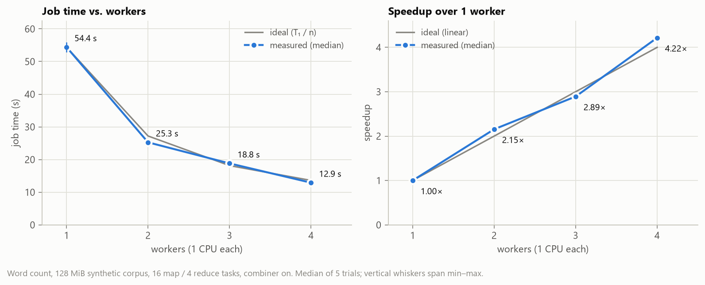
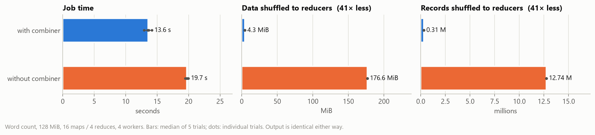
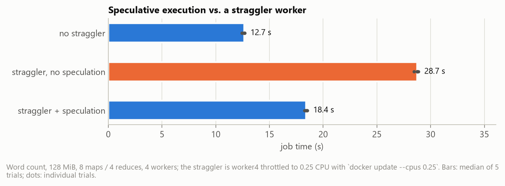
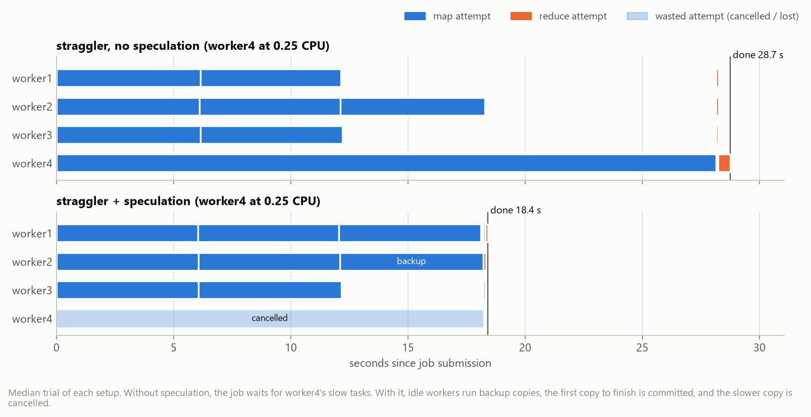
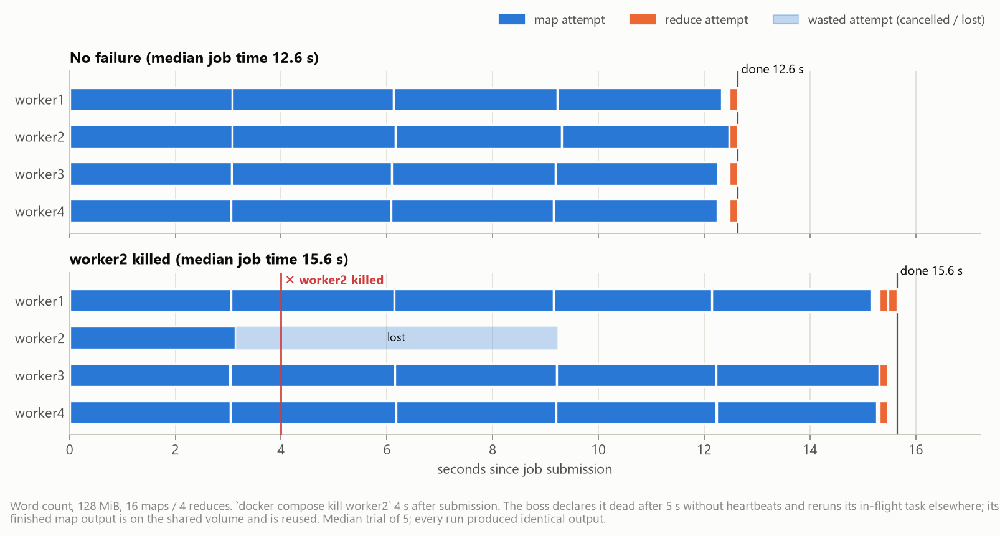

# MapReduce on Docker Compose

A from-scratch MapReduce for the CS 544 honors project. A **boss** and **four 1-CPU
workers** run in Docker Compose and share a Docker volume. A command-line client on the
host uploads data, submits jobs written as plain Python files, and reads the results.

Beyond basic MapReduce, it has three special features, each tested and measured:

| Feature | What it does | Evidence |
|---|---|---|
| **Combiners** | Map tasks pre-aggregate each key's values before the shuffle | [combiner plot](#combiners) |
| **Worker failure handling** | Heartbeats; a dead worker's in-flight tasks are re-run elsewhere | [failure timeline](#worker-failure) |
| **Speculative execution** | Backup copies of straggler tasks; the first copy to finish wins | [speculation plots](#speculative-execution) |

The design and its rationale are in **[design.md](design.md)**.

---

## Contents

1. [Quick start](#1-quick-start) (about 5 minutes)
2. [Writing a MapReduce job](#2-writing-a-mapreduce-job)
3. [Client reference](#3-client-reference)
4. [Demo of the special features](#4-demo-of-the-special-features)
5. [Performance evaluation](#5-performance-evaluation)
6. [Tests and CI](#6-tests-and-ci)
7. [How it works and repository layout](#7-how-it-works-and-repository-layout)

---

## 1. Quick start

**Prerequisites:** Docker with the Compose plugin (`docker compose version`), and
Python 3.11+ with `venv` for the client (on Ubuntu: `sudo apt install python3-venv`).

### 1.1 Build and start the cluster

```bash
git clone https://github.com/nullPtrErikaS/544-honors-project.git
cd 544-honors-project
docker compose up -d --build
```

This builds one image, `mapreduce:latest`. The protobuf/gRPC code is generated inside it
during the build. Compose then starts `boss` (port 5440 on the host) and `worker1`–`worker4`,
each limited to 1 CPU, all mounting the `mrdata` volume at `/data`.

### 1.2 Install the client

The client runs on the host, outside the containers:

```bash
python3 -m venv venv
source venv/bin/activate
pip install -r requirements.txt
python -m mapreduce.protogen     # generate mapreduce/mr_pb2*.py for the client
./mr wait-ready                  # waits until the boss and all 4 workers are up
```

`./mr` is a small wrapper for `python3 -m mapreduce.client`. It uses whichever
`python3` is first on your `PATH`, so keep the venv activated (or set `PYTHON=...`).

### 1.3 Upload example data to shared storage

```bash
./mr upload examples/data/sample inputs/sample
./mr ls inputs/sample
```

`examples/data/sample/` holds three small text files. For a bigger input, generate a
synthetic corpus (deterministic, Zipf-distributed words) and upload it:

```bash
python scripts/gen_corpus.py --size-mb 128 --files 16 data/corpus   # about 5 s
./mr upload data/corpus inputs/corpus
```

### 1.4 Submit a job

```bash
./mr submit --input inputs/sample --output outputs/wordcount \
            --job examples/jobs/wordcount.py --maps 8 --reduces 4
```

`submit` shows progress until the job finishes, then prints a summary:

```
submitted job-0001
job-0001  SUCCEEDED  maps 8/8  reduces 4/4     0.1s
job-0001  wordcount.py  SUCCEEDED  (0.06s)
  input:    inputs/sample
  output:   outputs/wordcount
  maps:     8/8
  reduces:  4/4
  options:  combiner on, speculation on
  counters:
    combine_input_records                322
    ...
```

### 1.5 Look at the output

```bash
./mr ls outputs/wordcount            # _SUCCESS, part-r-00000 ... part-r-00003
./mr cat outputs/wordcount | sort -t$'\t' -k2 -nr | head
./mr status job-0001                 # counters and every task attempt (worker, timing)
```

To check correctness, run the same job sequentially on the local copy and compare:

```bash
diff <(./mr cat outputs/wordcount | sort) \
     <(./mr local --job examples/jobs/wordcount.py --input examples/data/sample | sort) \
  && echo identical
```

`scripts/smoke_test.sh` does all of 1.3–1.5 in one go (CI runs it).

### 1.6 Shut down

```bash
docker compose down -v    # -v also deletes the shared volume
```

---

## 2. Writing a MapReduce job

A job is one Python file that defines `mapper` and `reducer`, and optionally `combiner`.
This is the complete [`examples/jobs/wordcount.py`](examples/jobs/wordcount.py):

```python
import re

WORD = re.compile(r"[a-z0-9']+")


def mapper(key, value):
    """key: input file path, value: one line of text."""
    for word in WORD.findall(value.lower()):
        yield word, 1


def reducer(key, values):
    """values: every count emitted for this word."""
    yield key, sum(values)


# Optional: pre-aggregate counts on the map side before the shuffle. A combiner has the
# reducer's signature and must keep the key. Summing is associative, so the reducer works.
combiner = reducer
```

The contract:

- **Input**: text files. `mapper(key, value)` is called once per line, with `key` = the
  input file's path in shared storage and `value` = the line without its newline.
  `--input` may be a file or a directory (read recursively; names starting with `_` or `.`
  are skipped). The input is split into `--maps` byte ranges of equal size, regardless of
  how many files there are.
- **Mapper, reducer, and combiner** `yield` (or return a list of) `(key, value)` pairs.
  Keys and values must be JSON-serializable: str, int, float, bool, None, list, or dict.
- **reducer(key, values)** receives every value for one key as an iterator. Keys are
  partitioned across `--reduces` reduce tasks by a stable hash, and each reduce task sees
  its keys in sorted order.
- **combiner(key, values)** is optional. It must emit the same key it was given. Jobs run
  it by default; disable it with `--no-combiner`.
- **Output**: `--output` becomes a directory of `part-r-NNNNN` files (one per reduce task)
  plus `_SUCCESS`. Each line is `key<TAB>value`; strings are written as-is and everything
  else as JSON.
- Functions must be **deterministic**, because tasks can run more than once (retries and
  backups).

Test a job on your own machine before submitting it: `./mr local --job myjob.py --input
some/local/dir`. A second example,
[`examples/jobs/inverted_index.py`](examples/jobs/inverted_index.py), uses the mapper's
`key`:

```bash
./mr submit --input inputs/sample --output outputs/index \
            --job examples/jobs/inverted_index.py --maps 4 --reduces 2
./mr cat outputs/index | awk -F'\t' '$1 == "worker"'
# worker	["inputs/sample/docker.txt", "inputs/sample/mapreduce.txt"]
```

If the user code raises, the attempt fails and is retried on another worker. After 4
failures of one task the job fails, and `./mr status <job>` shows the remote traceback with
your file's line numbers.

---

## 3. Client reference

All commands talk to `$MR_BOSS` (default `localhost:5440`). Storage paths are relative to
the shared volume's root.

| Command | Description |
|---|---|
| `./mr upload LOCAL REMOTE` | Copy a local file or directory into shared storage |
| `./mr ls [PATH]` | List a directory in shared storage |
| `./mr cat PATH` | Print a file, or all `part-*` files of an output directory |
| `./mr download REMOTE LOCAL` | Copy a file or directory out of shared storage |
| `./mr rm PATH` | Delete a file or directory |
| `./mr submit --input IN --output OUT --job FILE.py --maps M --reduces R` | Run a job and wait for it to finish |
| &nbsp;&nbsp;&nbsp;&nbsp;`--overwrite` | Replace OUT if it already exists (otherwise the job is rejected) |
| &nbsp;&nbsp;&nbsp;&nbsp;`--no-combiner` / `--no-speculation` | Turn a feature off for this job |
| &nbsp;&nbsp;&nbsp;&nbsp;`--detach` | Print the job id and return immediately |
| `./mr status JOB [--json]` | Progress, counters, and every task attempt (worker, start/end, outcome) |
| `./mr jobs` | All jobs |
| `./mr workers` | Workers: alive or dead, what they are running, tasks completed |
| `./mr wait-ready [--workers N]` | Block until the boss and N workers are up |
| `./mr local --job FILE.py --input LOCALPATH` | Run a job sequentially on local files |

---

## 4. Demo of the special features

Start with a bigger input so tasks take a few seconds each (see 1.3):

```bash
python scripts/gen_corpus.py --size-mb 128 --files 16 data/corpus && ./mr upload data/corpus inputs/corpus
```

In a second terminal, run `docker compose logs -f boss` to watch the boss assign tasks,
detect failures, and launch backups.

**Combiner.** Run word count with and without the combiner and compare the
`intermediate_bytes` / `intermediate_records` counters (the data shuffled to reducers) and
the job time:

```bash
./mr submit --input inputs/corpus --output outputs/wc --job examples/jobs/wordcount.py --maps 16 --reduces 4 --overwrite
./mr submit --input inputs/corpus --output outputs/wc --job examples/jobs/wordcount.py --maps 16 --reduces 4 --overwrite --no-combiner
```

**Worker failure.** Kill a worker container in the middle of a job:

```bash
./mr submit --input inputs/corpus --output outputs/wc --job examples/jobs/wordcount.py \
            --maps 16 --reduces 4 --overwrite --detach
sleep 4; docker compose kill worker2
./mr workers                  # after ~5 s: worker2 DEAD
./mr status job-000N          # LOST attempt on worker2, re-run on another worker
docker compose start worker2  # it rejoins and picks up work again
```

The job still succeeds with the same output. Map tasks that worker2 had already finished
are **not** re-run, because their output is on the shared volume rather than inside the
dead container.

**Speculative execution.** Make worker4 a straggler by limiting it to a quarter of a CPU,
then compare:

```bash
docker update --cpus 0.25 $(docker compose ps -q worker4)
./mr submit --input inputs/corpus --output outputs/wc --job examples/jobs/wordcount.py --maps 8 --reduces 4 --overwrite --no-speculation
./mr submit --input inputs/corpus --output outputs/wc --job examples/jobs/wordcount.py --maps 8 --reduces 4 --overwrite
./mr status job-000N          # "backups: k launched, ..." and attempts marked "backup"
docker update --cpus 1 $(docker compose ps -q worker4)
```

---

## 5. Performance evaluation

All measurements come from the system itself. The boss records when each job was submitted
and finished, plus the worker, start, end, and outcome of every task attempt.
[`bench/run.py`](bench/run.py) drives the real Docker Compose cluster through the client
API and stores each run in `bench/results/*.jsonl`. [`bench/plot.py`](bench/plot.py) draws
the plots from those files.

**Setup.** Word count over a synthetic 128 MiB corpus (`scripts/gen_corpus.py`: 16 files,
20,000-word vocabulary, Zipf-distributed). Each configuration was run **5 times** after one
discarded warm-up run. Plots show the median, with min–max ranges or the individual
trials. All 55 runs produced byte-identical output (same SHA-256). We ran the experiments on
Docker Desktop (WSL2) on a 20-core machine. Every worker is capped at 1 CPU, as on the
4-CPU VM, but absolute times on the VM will differ. To reproduce (about 40 minutes):

```bash
pip install -r requirements-dev.txt
python bench/run.py all --trials 5     # needs the cluster running
python bench/plot.py                    # writes docs/plots/*.png
```

### Scalability



Job time falls from 54.4 s on one worker to 12.9 s on four, close to linear. Workers pull
tasks, so no worker sits idle while there is work. 16 map tasks spread evenly over 1, 2, or
4 workers, and the reduce phase is short (about 0.2 s per task) because the combiner has
already shrunk the data. Three workers fall a little short of ideal (2.89×) because 16 tasks
don't divide evenly into 3: the last wave runs one task on one worker. The 4.22× at four
workers is slightly *above* linear. The measurements explain why: each map task took a
median of 3.3 s in the 1-worker runs, against 3.1 s in all other configurations, so the
baseline is about 7% slow. That is most likely an artifact of CPU-quota accounting on our
host, not of the system.

### Combiners



Without the combiner, every word occurrence becomes an intermediate record: 12.7 million
records and 177 MiB are sorted, written to the shared volume, and merged by the reducers.
With `combiner = reducer`, each map task's spills and final merge collapse the counts to one
record per distinct word per map task. That is **41× less** data shuffled (4.3 MiB, 0.31 M
records), and the job finishes **31% faster** (13.6 s vs. 19.7 s). The time saving is smaller
than the data saving because both versions still have to read and tokenize the full
128 MiB, which dominates.

### Speculative execution





For this experiment worker4 is throttled to 0.25 CPU, a straggler like a machine with a
noisy neighbor, and the job uses 8 map tasks so that each one is substantial. **Without
speculation** (top Gantt chart), worker4's single map task takes 28 s. The other workers
finish everything else by 18 s and then sit idle while the whole job waits:
**28.7 s, 2.3×** the 12.7 s no-straggler baseline. **With speculation** (bottom), at about
12 s worker2 runs out of pending work. worker4's task has by then run more than 1.5× the
median map time, so worker2 starts a backup copy. The backup finishes first at 18.2 s, its
output is committed, and worker4's copy is cancelled through the heartbeat. Job time drops
to **18.4 s (36% faster)**, and the five trials agree to within 0.3 s.

The remaining gap to the baseline is by design. A backup only starts when there is no
pending work, and only after the original has run longer than 1.5× the median task, so
it has a reliable signal that the task is a straggler. In exchange, it never takes a worker
away from useful work.

### Worker failure



4 s after submission, `docker compose kill worker2` removes a worker in the middle of its
second map task. Its heartbeats stop, the boss declares it dead 5 s later (at about 9 s), and
the task is marked `LOST` and becomes pending again. A surviving worker re-runs it as soon
as one is free. The map task worker2 had **already finished is not re-run**, because its
output is on the shared volume. All 5 failure runs succeeded with output identical to the
failure-free runs. The job took **15.6 s instead of 12.6 s**. The 3 s penalty is about one
map task's worth of work. The 5 s detection timeout is hidden because the surviving workers
had pending tasks the whole time; the cost is losing a quarter of the cluster's capacity for
the rest of the job.

### Limitations

- The boss is a single point of failure (as in the MapReduce paper). If it dies, in-flight
  jobs are lost.
- Python and JSON make per-worker throughput modest (about 2.4 MiB/s for word count on one CPU).
  Scalability, not raw speed, was the goal.
- All storage is one Docker volume, so there is no data locality to exploit. This is fine on
  a single VM, but a multi-host deployment would need a distributed file system.

---

## 6. Tests and CI

```bash
pip install -r requirements-dev.txt
pytest          # about 30 s; generates the protobuf code automatically if needed
ruff check . && ruff format --check .
```

| File | What it covers |
|---|---|
| `tests/test_splits.py` | Input splitting. Includes a property test: over 300 random files and split counts (empty lines, CRLF, no trailing newline, multi-byte UTF-8), every line is read by exactly one split |
| `tests/test_kv.py` | Partitioner is stable across processes (different `PYTHONHASHSEED`), sorted-run merge, output format |
| `tests/test_jobcode.py` | Job file validation without executing it, loading, tracebacks show user source lines |
| `tests/test_tasks.py` | Map and reduce tasks against the sequential oracle for various M/R and spill thresholds; combiner correctness and data reduction; cancellation |
| `tests/test_scheduler.py` | Scheduler state machine with a fake clock: phases, FIFO, retries and failure limit, dead workers, rejoining workers, speculation thresholds and winners |
| `tests/test_integration.py` | Real boss and worker **processes** over gRPC: output equals `mr local`, storage RPCs, error handling, the CLI, a worker killed mid-job, a 25× slower worker beaten by backups, combiner on/off |

GitHub Actions ([`.github/workflows/ci.yml`](.github/workflows/ci.yml)) runs on every pull
request:
1. lint and all of the tests above, and
2. an end-to-end job that builds the images, starts the real Compose cluster, and runs
   `scripts/smoke_test.sh` (upload, word count, diff against `mr local`).

---

## 7. How it works and repository layout

```
client (host) --gRPC--> boss <--gRPC-- worker1..4
                          \              /
                       shared volume /data
```

1. `mr submit` sends the job file's source and parameters to the boss. The boss checks the
   file with `ast` (it never executes it), cuts the input into M byte-range splits, and
   queues the job.
2. Workers **pull** tasks with a long-polling `RequestTask` RPC. A map task reads its split,
   runs `mapper`, partitions output by `crc32(key) % R`, sorts and spills to disk (applying
   the combiner), and writes R sorted files into a private attempt directory.
3. When every map task is committed, reduce tasks k-way-merge their partition from every
   map's output, run `reducer`, and write to a private temp file. The boss atomically
   renames the first successful attempt's file into place.
4. Workers heartbeat every second. The boss uses this to detect dead workers, and replies
   with attempts the worker should cancel (losing backup copies).

| Path | Contents |
|---|---|
| `design.md` | Design document: decisions and rationale |
| `mapreduce/mr.proto` | gRPC services and messages |
| `mapreduce/boss.py` | Boss process: gRPC services, storage API, dead-worker reaper |
| `mapreduce/scheduler.py` | Job/task/attempt state machine, scheduling, speculation, failure handling (pure logic, fake-clock testable) |
| `mapreduce/worker.py` | Worker process: pull loop, heartbeats, cancellation |
| `mapreduce/tasks.py` | Running one map task (buffer, spill, combine, merge) or one reduce task |
| `mapreduce/splits.py`, `kv.py`, `jobfiles.py` | Input splits, intermediate format and partitioning, commit protocol and file layout |
| `mapreduce/client.py`, `mr` | Command-line client |
| `mapreduce/local.py` | Sequential reference implementation (`mr local`, test oracle) |
| `examples/` | Example jobs and sample data |
| `scripts/` | Corpus generator and Docker smoke test |
| `bench/` | Benchmark runner, raw results (`results/*.jsonl`), and plotting script |
| `docs/plots/` | Generated plots |
| `tests/` | Unit and integration tests |

Configuration, through environment variables in `docker-compose.yml` (all optional):

| Variable | Default | Used by |
|---|---|---|
| `MR_BOSS` | `localhost:5440` | client, workers (`boss:5440` in Compose) |
| `MR_DATA` | `/data` | boss, workers: storage root |
| `MR_HEARTBEAT_INTERVAL` | `1.0` s | workers |
| `MR_WORKER_TIMEOUT` | `5.0` s | boss: silence before a worker is declared dead |
