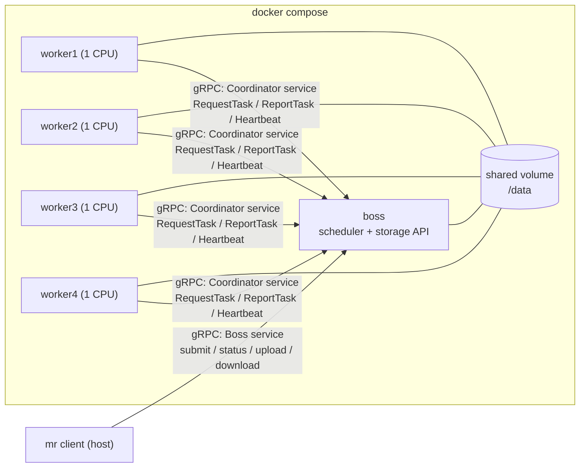

# Design: MapReduce on Docker Compose

This document records the key design decisions for our MapReduce implementation.
It answers the questions from the project spec and explains *why* each choice was made.

## 1. Goals and non-goals

**Goals**

- Run user-supplied Python `mapper`/`reducer` (and optional `combiner`) functions over text
  data in shared storage, using one boss and four 1-CPU worker containers on a single VM.
- Get a near-linear speedup from 1 to 4 workers on CPU-bound jobs.
- Special features (see §8):
  1. **Combiners** to shrink intermediate data.
  2. **Worker failure handling**: a job still finishes, with correct output, if a worker
     container is killed mid-job.
  3. **Speculative execution**: backup copies of straggler tasks, so one slow worker does not
     hold up the whole job.

**Non-goals**

- Boss fault tolerance. Like the original MapReduce paper, the boss is a single point of
  failure; if it dies, in-flight jobs are lost and must be resubmitted.
- Sandboxing user code. Job files run as ordinary Python code inside the worker containers.
- Multi-tenant fairness. Jobs run in FIFO order.

## 2. Architecture



- **boss**: one container. It holds all job state in memory, splits input, hands out
  tasks, detects dead workers, launches backup tasks, and commits task output. It also
  serves the storage API the client uses for uploads and downloads. Its port (5440) is
  published to the host.
- **worker1..4**: four containers built from the same image, each limited to 1 CPU
  (`cpus: 1.0`). Each worker runs one task at a time.
- **shared volume**: a Docker named volume mounted at `/data` in the boss and all workers.

## 3. Client interface

The client is a Python CLI (`./mr`, i.e. `python -m mapreduce.client`) that runs on the
host. It talks to the boss over gRPC at `localhost:5440` (override with `MR_BOSS`).

```bash
# Shared storage
./mr upload examples/data/sample inputs/sample     # local file or dir -> shared storage
./mr ls inputs/sample
./mr cat outputs/wc                                # concatenates part-r-* files
./mr download outputs/wc ./wc-output
./mr rm outputs/wc

# Jobs
./mr submit --input inputs/sample --output outputs/wc \
            --job examples/jobs/wordcount.py --maps 8 --reduces 4
./mr jobs                       # list jobs
./mr status job-0001 [--json]   # progress, attempts, counters
./mr workers                    # live/dead workers and what they are running

# Run a job sequentially on local files to test it (also used as the test oracle)
./mr local --job examples/jobs/wordcount.py --input examples/data/sample
```

By default `submit` waits and shows progress until the job finishes. Options:
`--no-combiner`, `--no-speculation`, `--overwrite` (replace an existing output
directory), and `--detach` (return as soon as the job is queued).

### Job file API

A job is one Python file. The client sends its source text to the boss inside the
`SubmitJob` request, and the boss passes it to workers along with each task.

```python
def mapper(key, value):        # key: input file path, value: one line (no newline)
    for word in value.split():
        yield word, 1

def reducer(key, values):      # values: iterator over all values for key
    yield key, sum(values)

combiner = reducer             # optional; same signature as reducer, must keep the key
```

Keys and values must be JSON-serializable (str, int, float, bool, None, list, dict).
`mapper` and `reducer` must be deterministic, because tasks may run more than once (retries
and backups). The boss checks the file with `ast.parse` when the job is submitted. That
catches syntax errors and missing functions early, without the boss executing user code.

## 4. Language

**Python 3.13** for everything: boss, worker, and client.
- Job files are Python, so workers must be Python to run them in-process with no
  serialization boundary.
- gRPC has good Python support, and the course already uses it.
- Python is slower than Java or Go, but the project is about distributed coordination rather
  than raw throughput. Each worker is limited to 1 CPU anyway, and per-worker throughput does
  not change the speedup we measure.

## 5. Communication

All RPCs use **gRPC with protobuf** (`mapreduce/mr.proto`). One boss process serves two
services on port 5440:

| Service | Caller | RPCs |
|---|---|---|
| `Boss` | client | `SubmitJob`, `GetJob`, `ListJobs`, `ListWorkers`, `Upload` (client-streaming), `Download` (server-streaming), `ListFiles`, `DeletePath` |
| `Coordinator` | workers | `RequestTask` (long poll), `ReportTask`, `Heartbeat` |

**Pull-based scheduling.** Workers *ask* for work instead of the boss pushing to them:
- No service discovery is needed. Workers only need the boss address, and the boss learns
  about workers when they first call it. Adding or removing workers needs no
  configuration.
- Load balancing is automatic. A fast worker comes back for more work sooner, so it
  gets more tasks.
- `RequestTask` is a **long poll**. When no task is available, the boss holds the call for up
  to 1 s on a condition variable, so a task is handed out as soon as one becomes available
  without workers busy-polling.

**Heartbeats.** A background thread in each worker sends `Heartbeat(worker_id,
running_attempt_ids)` every second. The reply carries a list of attempts the worker should
cancel. This is how the boss stops a losing speculative copy or an attempt it has already
written off.

## 6. Shared storage

**A Docker named volume (`mrdata`) mounted at `/data` in the boss and all workers.**

- We deploy on one VM, so a local volume is truly shared. It also survives the death of any
  worker container, which simplifies fault tolerance (§8.2).
- HDFS would add three JVM services and a lot of setup without adding anything that matters
  on a single host.
- The client does **not** mount the volume. It reads and writes it through the boss's
  `Upload`/`Download` streaming RPCs (1 MiB chunks), so the client works the same whether the
  volume is local or not.
- All user-facing paths are relative to `/data`. The boss rejects absolute paths and `..`.

Layout:

```
/data/
  inputs/...                          # user data (uploaded)
  outputs/<name>/part-r-00000 ...     # job output, plus _SUCCESS marker
  _jobs/<job-id>/map/<attempt-id>/part-00000.kv   # intermediate (deleted on success)
  outputs/<name>/_temporary/<attempt-id>/         # reduce output before commit
```

## 7. Data formats and execution

### Input: text lines, split by byte range
The input path is a file or a directory (read recursively; files whose names start with
`_` or `.` are skipped). The boss adds up the input size and cuts it into
`num_map_tasks` **byte-range splits** of about equal size. A split may span several small
files, and a large file may be cut across several splits, so the number of map tasks does
not depend on the number of files.

Splits are cut at arbitrary byte offsets, so record boundaries use the Hadoop
`TextInputFormat` rule: *a split owns every line that starts inside its byte range.* A
reader that starts at offset `s > 0` skips forward past the first newline at or after `s-1`.
It then keeps reading lines while the line's start offset is `< end`, even if the last line
runs past `end`. Every line is read by exactly one split, and a property-based test checks
this.

`mapper(key, value)` gets `key = input file path` (relative to `/data`) and
`value = line` (UTF-8 decoded, without the trailing newline).

### Intermediate data: sorted, JSON-encoded key/value lines
Each map task writes one file per reduce partition:
`_jobs/<job>/map/<attempt>/part-<r>.kv`. Every line is

```
<json(key)> \t <json(value)> \n
```

and each file is **sorted by the JSON-encoded key string**.
- JSON keeps types (ints stay ints) and is language-neutral and easy to inspect with `cat`
  when debugging. `json.dumps` escapes tabs and newlines, so `\t` is a safe separator.
- Sorting by the *encoded* key gives a total order even for keys of mixed types, and the
  reducer can compare keys without decoding them.
- **Partitioning** uses `crc32(json(key)) % R`. We cannot use Python's built-in `hash()`:
  it is randomized per process (`PYTHONHASHSEED`), so two map workers would send the same key
  to different reducers.
- **Spilling.** A map task buffers output in memory and, past a threshold (default 500k
  records), sorts it and writes ("spills") a sorted run to disk. When the task finishes, the
  runs are merged with `heapq.merge`. Map tasks therefore use bounded memory on large splits.

The reducer streams a k-way merge (`heapq.merge`) over its partition file from every map task
and groups adjacent equal keys with `itertools.groupby`. It decodes values lazily, so the
reduce side also runs in bounded memory and never sorts in memory.

We considered Arrow/Parquet and protobuf for intermediate data. They would be faster and
more compact, but they need a schema, and our keys and values are arbitrary JSON-like Python
objects. Line-oriented JSON is simpler and debuggable, and it was fast enough for this
project.

### Output: TSV text
Each reduce task writes `part-r-<NNNNN>`, one `key\tvalue` line per record. A string is
written as-is, and any other value is written as JSON. The output is plain text, so it can be
the input of another job, and `./mr cat outputs/wc | sort -t$'\t' -k2 -nr | head` just works.
When the job succeeds, the boss writes an empty `_SUCCESS` marker.

### Commit protocol (the boss is the only committer)
A task may run several times at once (a backup copy) or one after another (retries). Every
**attempt** therefore writes to its own private location, and the boss decides which attempt
"wins":
- **Map**: the attempt writes `_jobs/<job>/map/<attempt-id>/`. The first successful
  `ReportTask` for the task is recorded as committed, and reduce tasks are told to read only
  from committed attempt directories. Later duplicates are ignored and deleted.
- **Reduce**: the attempt writes `<output>/_temporary/<attempt-id>/part-r-NNNNN`. On the
  first successful report, the boss `os.replace`s it to `<output>/part-r-NNNNN`. The rename is
  atomic, so readers never see a partially written file.
- On job success the boss writes `_SUCCESS` and deletes `_temporary` and the intermediate
  directory.

## 8. Special features

### 8.1 Combiners
If the job file defines `combiner` (and `--no-combiner` was not given), map tasks apply it to
each key's buffered values **at every spill and again during the final merge of spills**. For
word count, this turns millions of `(word, 1)` records into one record per distinct word per
map task. Counters (`map_output_records`, `combine_output_records`, `intermediate_bytes`)
measure the effect.

### 8.2 Worker failure handling
- The boss tracks `last_seen` for every worker (any RPC counts). A reaper thread declares a
  worker **dead** after 5 s of silence (heartbeats arrive every 1 s).
- Every attempt that was running on a dead worker is marked `LOST`. If its task has no other
  running attempt, the task goes back to `PENDING` and another worker picks it up.
- **Completed map tasks are not re-run**, unlike in the original paper. Their output is on
  the shared volume, not on the dead worker's local disk, so it is still readable.
- If a "dead" worker comes back, the heartbeat reply tells it to cancel the attempts the boss
  has written off. A late `ReportTask` from a lost attempt is rejected.
- Exceptions in user code mark the attempt `FAILED`, and the task is retried on any worker.
  After 4 failed attempts of one task, the job fails and the user sees the remote traceback.
  `LOST` attempts do not count toward this limit.

### 8.3 Speculative execution (backup tasks)
When a worker asks for work and **no task is pending**, the boss looks for a straggler in the
current phase (map or reduce):
- the task has exactly one running attempt, on a different worker;
- at least one task in that phase has finished, which gives us a baseline;
- the attempt has run longer than `max(1 s, 1.5 × median duration of finished tasks in the
  phase)`.

The longest-running candidate gets a **backup attempt** on the idle worker. The first attempt
to finish is committed (§7), and the boss tells the other worker to cancel via the next
heartbeat. Workers check for cancellation every 1,000 records, so the loser stops within
milliseconds and its CPU is freed. Speculation can be turned off per job with
`--no-speculation`, which we use to measure its effect.

## 9. Testing plan

All tests run with `pytest` in GitHub Actions on every pull request.

| Level | What | How |
|---|---|---|
| Unit | Split computation | Property test: random files, random line lengths (including empty lines, no trailing newline, `\r\n`), random `M`. The union of records from all splits equals the lines of the files, each exactly once. |
| Unit | Partitioner | Stable across processes (subprocess with different `PYTHONHASHSEED`), in range. |
| Unit | Map/reduce task execution | Spill + merge produce sorted output; combiner applied; output matches sequential reference. |
| Unit | Job file validation | Missing `mapper`, syntax errors, combiner detection. |
| Unit | Scheduler state machine | Fake clock, no threads or network: assignment order, phase transition, retries, failure limit, dead worker → tasks rescheduled, speculation threshold and selection, duplicate commit rejected, cancellation delivered via heartbeat. |
| Integration | Real boss + workers as local subprocesses, temp dir as storage | Word count and inverted index produce exactly the output of `mr local`. |
| Integration | Failure | Kill a worker process mid-job; the job still succeeds with correct output and the status shows `LOST` attempts. |
| Integration | Stragglers | One deliberately slow worker; backup attempts are launched and win. |
| End-to-end | Docker Compose | CI builds the images, starts boss + 4 workers, uploads sample data with the real client, runs word count, and diffs the output against `mr local`. |

## 10. Performance evaluation plan

All experiments run against the real Docker Compose deployment (4 workers × 1 CPU), on a
synthetic Zipf-distributed text corpus that `scripts/gen_corpus.py` generates
deterministically. Each configuration is repeated (3–5 trials) and we report the median
with min/max error bars. Scripts live in `bench/`; raw results go to `bench/results/` and
plots to `docs/plots/`.

1. **Scalability**: job time vs. number of live workers (1–4) for word count, against
   ideal linear speedup. *Expectation*: close to linear, limited by the serial reduce tail
   and coordination overhead.
2. **Combiner**: with vs. without combiner: job time, intermediate bytes, and map output
   records. *Expectation*: intermediate data shrinks by orders of magnitude, and the
   job gets faster because less is sorted, written, and read.
3. **Speculative execution**: worker4 throttled to 0.25 CPU (`docker update --cpus 0.25`),
   job time with vs. without speculation, plus a no-straggler baseline. A per-worker
   **Gantt chart** of task attempts shows the backup tasks. *Expectation*: with speculation,
   job time stays close to the no-straggler baseline.
4. **Failure recovery**: kill a worker partway through the map phase. Gantt chart
   showing the `LOST` attempts and their re-execution, and job time vs. a failure-free run.
   *Expectation*: the job completes with correct output, and the time penalty is about the
   lost work plus the 5 s detection timeout.

The boss records the start/end time, worker, and outcome of every attempt, and `mr status
--json` returns them, so every plot is built from the system's own measurements.

## 11. Engineering process

- `main` is protected by convention. All work lands through small pull requests from
  feature branches, roughly one per row: design → data path → CI → boss/worker/client →
  Docker → fault tolerance → speculation → combiner → benchmarks → docs.
- GitHub Actions runs lint (`ruff`), unit tests, integration tests, and the Docker
  end-to-end test on every PR.
- Solo project: an AI agent reviews pull requests and leaves comments on the PR, and we
  respond to and address the comments.
